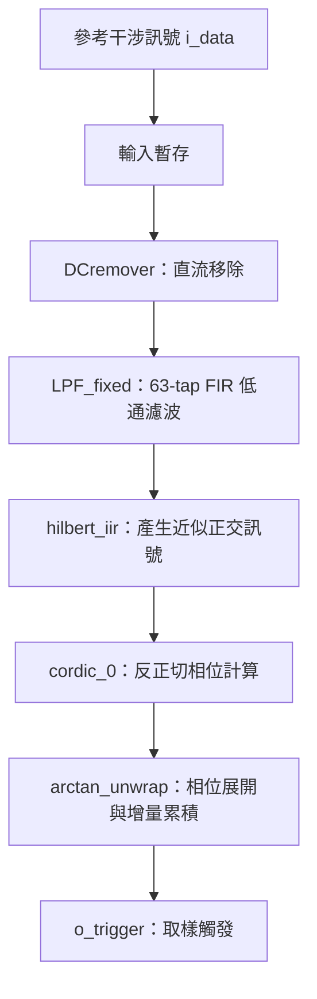

# External Clock Generator for OCT

以 Verilog 實作的 OCT 外部取樣觸發產生器。專案針對掃頻式光學同調斷層掃描（Swept-Source Optical Coherence Tomography, SS-OCT）的參考干涉訊號進行即時數位處理，目標是在 FPGA 上追蹤訊號相位，產生對應等波數（equal-k）間距的取樣觸發，作為 OCT 訊號取樣或後續重取樣的依據。

目前儲存庫包含訊號處理 RTL、Xilinx CORDIC IP 設定與離線資料模擬用 testbench，屬於演算法硬體化與整合驗證階段。

## 專案在做什麼？

SS-OCT 的掃頻光源，其波數 `k` 隨時間的變化可能不是線性的。因此，固定時間間隔取得的 OCT 資料，不一定對應等間距的波數座標。本專案利用參考干涉訊號的相位變化，建立波數變化的追蹤依據。

依照程式中的 `mzi2k` 命名及測試資料用途，參考訊號預期來自 Mach–Zehnder interferometer（MZI）。在固定光程差的參考干涉儀中，相位變化與波數變化成正比，因此可依指定相位間距產生觸發，供 OCT 資料選點或重取樣使用。實際光路與光程差需由系統設定補充。

本專案的工作重點如下：

1. 移除輸入參考訊號的直流成分。
2. 透過低通濾波抑制高頻雜訊。
3. 使用 IIR Hilbert 轉換建立近似正交的實部與虛部訊號。
4. 使用 CORDIC 計算相位，並進行相位展開（phase unwrapping）。
5. 累積相位增量，達到設定門檻時輸出取樣觸發 `o_trigger`。

## 訊號處理架構

以下為 `ExternalClkGen_TOP.v` 目前實際串接的流程：



`o_trigger` 是依相位門檻產生的事件脈衝，並非固定頻率的自由振盪時鐘。能否直接作為外部 ADC 的取樣時鐘，仍須配合 FPGA 輸出時序、脈波寬度與 ADC 規格進行驗證。

## 檔案與模組

```text
External_Clock_Generator/
├── Verilog/
│   ├── new/
│   │   ├── ExternalClkGen_TOP.v   # 頂層訊號處理串接
│   │   ├── DCremover.v           # 直流成分移除
│   │   ├── LPF_fixed.v           # 頂層目前使用的固定點 FIR 低通濾波器
│   │   ├── LPF.v                 # testbench 目前使用的另一版 FIR 實作
│   │   ├── hilbert_iir.v         # IIR Hilbert 正交訊號產生器
│   │   ├── arctan_unwrap.v       # CORDIC 串接、相位展開與觸發產生
│   │   └── IIR.v                 # 額外的 IIR 直流估測／移除實作
│   └── ip/
│       └── cordic_0/
│           └── cordic_0.xci      # Xilinx CORDIC IP 設定
└── testbench/
    └── sim_1/new/
        └── tb_mzi2k_hilbert.v    # 參考訊號與 OCT 資料的離線模擬
```

| 模組 | 功能與目前用途 |
| --- | --- |
| `ExternalClkGen_TOP` | 接收參考訊號，串接 DC 移除、低通濾波、Hilbert 轉換與相位觸發。預設 `WIDTH = 16`。 |
| `DCremover` | 以遞迴運算與差分移除直流成分，輸出有號資料。 |
| `LPF_fixed` | 63-tap FIR，係數乘積先做固定點縮放再累加；目前頂層使用此版本。 |
| `LPF` | 另一版 63-tap FIR，在累加結果取位輸出；目前 testbench 使用此版本。 |
| `hilbert_iir` | 透過兩路遞迴濾波網路產生近似正交的實部與虛部，供相位估測使用。 |
| `arctan_unwrap` | 呼叫 `cordic_0` 計算相位，補償相位跳變，並以相位增量累積結果產生觸發。 |
| `IIR` | 追蹤低頻／直流分量並輸出扣除結果；未串接於目前頂層的主要處理路徑。 |

## 頂層介面

| 訊號 | 方向 | 說明 |
| --- | --- | --- |
| `clk` | 輸入 | FPGA 系統處理時鐘。 |
| `rst_n` | 輸入 | 低有效非同步重置；CORDIC IP 本身未啟用 reset 介面。 |
| `i_data[WIDTH-1:0]` | 輸入 | 參考干涉訊號樣本；DC 移除模組目前以無號輸入方式處理，需確認與 ADC 資料編碼一致。 |
| `i_valid` | 輸入 | 輸入資料有效標記。各級對此訊號的處理方式不同，間歇輸入的行為仍需驗證。 |
| `o_trigger` | 輸出 | 相位累積達到門檻時產生的觸發；目前實作會與 `clk` 高電位及內部有效訊號組合。 |
| `o_valid` | 輸出 | 頂層已宣告，但目前尚未驅動，不能用作有效輸出判斷。 |

## 開發與模擬

本專案使用 Verilog 與 Xilinx CORDIC IP，預期透過 Vivado 建立工程及執行模擬。儲存庫目前未附完整 `.xpr` 工程、板級腳位／時序約束或測試用原始資料。

1. 建立 Vivado RTL 工程，加入 `Verilog/new/` 內的 Verilog 原始碼。
2. 匯入 `Verilog/ip/cordic_0/cordic_0.xci`，依使用環境重新產生 IP output products 與模擬模型。現有 IP 設定記錄的元件為 `xc7z010i`、封裝 `clg225`、速度等級 `-1L`；更換目標時需重新確認設定。
3. 整合頂層時，將 `ExternalClkGen_TOP` 設為 design top；執行現有離線模擬時，加入 `tb_mzi2k_hilbert.v` 並設為 simulation top。
4. 準備下列十六進位文字資料，修改 testbench 中 `$readmemh` 與 `$fopen` 的路徑：
   - `raw_k_clk.txt`：參考干涉訊號樣本。
   - `raw_oct_signal.txt`：對應的 OCT 訊號樣本。
   - `oct_signal_mzi2k.coe`：觸發選取 OCT 樣本後的輸出檔名；目前程式寫出的是逐行十六進位值，未包含標準 COE 標頭。
5. 執行模擬，觀察濾波結果、Hilbert 實／虛部、CORDIC 相位、展開後相位與觸發位置，再檢查輸出的 OCT 樣本。

現有 testbench 的時鐘週期為 20 ns（50 MHz），輸入迴圈處理 14,208 筆樣本。這是模擬設定，並非已驗證的硬體最高工作頻率。

## 目前狀態與整合注意事項

目前程式已包含完整的相位追蹤與觸發處理路徑，但下列項目仍需在實際系統整合前確認：

- **CORDIC 資料寬度**：`.xci` 設定每個 Cartesian 分量為 32-bit，合計 64-bit 輸入；`arctan_unwrap` 預設將兩個 16-bit 分量串接成 32-bit，與現有 IP 設定不一致。應先統一位寬、符號延伸與固定點格式。
- **相位單位與門檻**：IP 使用 `Scaled_Radians`，程式部分註解則以弧度描述。`FIXED_FREQ`、`K_grid` 與 unwrap 常數需依實際相位編碼核對，不能直接把註解中的數值視為實際相位間距。
- **有效訊號與延遲**：CORDIC 輸入 valid 目前固定為有效，輸出 `arctan_ovalid` 尚未用於後續資料對齊；`arctan_unwrap.o_ready` 亦未驅動。濾波器的資料延遲、群延遲與 valid 對齊仍須一起驗證。
- **模擬與頂層的差異**：現有 testbench 直接串接各子模組，且使用 `LPF`；頂層使用 `LPF_fixed`。目前 testbench 不能直接代表頂層版本已通過驗證。
- **OCT 資料對齊**：testbench 中同時存在 `DELAY = 51` 與輸出索引 `i-70`，需依實際處理延遲重新校正。輸出條件目前只檢查 `i >= 0`，也需避免負索引存取。
- **重取樣與影像重建**：testbench 中的 `oct_remapping` 實例已註解，儲存庫未提供該模組。目前主要展示相位觸發與 OCT 樣本選取流程；尚未包含完整插值重取樣、FFT 或 OCT 影像重建。

本 README 依目前儲存庫中的 RTL、IP 設定及 testbench 整理；未宣稱已完成 FPGA 上板驗證、時序收斂或影像品質量測。
